# Documentación Técnica y Matemática del Proyecto
## Sistema Biométrico Multi-Rostro de Control de Acceso con PDI, Machine Learning, Deep Learning (CNN) e IoT

- **Enfoque:** Pipeline biométrico completo construido **desde cero** (sin `Haar Cascades`, sin `dlib`, sin `MediaPipe`, sin `FaceNet` preentrenado), integrando Procesamiento Digital de Imágenes (PDI), Eigenfaces (PCA), 5 clasificadores clásicos de Machine Learning, una Red Neuronal Convolucional 2D (CNN), verificación *Open-Set*, seguimiento multi-rostro y despliegue IoT en **ESP32-CAM + Pantalla OLED 0.96" + Bot de Telegram**.

---

## 1. Arquitectura Global del Sistema

```mermaid
flowchart LR
    CAM["ESP32-CAM OV2640<br/>Port 81: MJPEG 400x296<br/>Port 80: /acceso OLED"] -->|"Hilo 1: Socket TCP Zero-Buffer"| PDI["PDI Clásico<br/>YCrCb+RGB, Morfología,<br/>imfill, NMS, CLAHE, 64x64"]
    PDI -->|"Ventanas Candidatas"| E1["Etapa 1: Rostro vs Objeto<br/>PCA K=162 + MSE + 78 PDI<br/>Ensamble: SVM + CNN + RF"]
    E1 -->|"Rostros Humanos Confirmados"| TRK["Gestor Multi-Rostro<br/>Tracking IoU + EMA<br/>Hasta 4 rostros simultáneos"]
    TRK -->|"Cada Rostro"| E2["Etapa 2: Identidad Open-Set<br/>PCA K=180 + F_Identity (257D)<br/>Ensamble: k-NN+SVM+CNN+ANN+RF"]
    E2 -->|"Votación Temporal + Barrera Sync"| OR["Regla Global OR<br/>¿Al menos 1 Autorizado?"]
    OR -->|"GET /acceso?estado=..."| OLED["OLED 0.96 I2C (SSD1306)<br/>AUTORIZADO / DENEGADO / ESPERA"]
    OR -->|"POST sendPhoto + CSV"| TG["Bot Telegram + Bitácora CSV<br/>Foto, Nombre, Hora, Lugar"]
```



---

## 2. Stack Tecnológico y Dependencias

Definido en `requirements.txt` y librerías estándar de Python / Arduino:

| Capa | Tecnología / Librería | Uso Principal en el Proyecto |
| :--- | :--- | :--- |
| **Cómputo Científico** | `numpy >= 1.24.0`, `scipy >= 1.11.0` | Álgebra matricial, vectores faciales 4096D, distancias euclidianas, similitud coseno, estadísticas y proyecciones. |
| **Visión / PDI** | `opencv-python >= 4.8.0` | Conversión de espacios de color (`BGR/RGB/YCrCb`), mediana, Gaussiano, CLAHE, Sobel, Laplaciano, morfología, contornos, `filter2D`, interfaz GUI en vivo. |
| **Machine Learning / DL** | `scikit-learn >= 1.3.0` | `PCA` (Eigenfaces), `StandardScaler`, `KNeighborsClassifier`, `DecisionTreeClassifier`, `RandomForestClassifier`, `SVC`, `MLPClassifier`, `StratifiedKFold`, `GridSearchCV`, `NearestNeighbors`, `fetch_olivetti_faces`. |
| **Serialización** | `joblib >= 1.3.0` | Guardado y carga rápida de modelos, escaladores, matrices PCA y metadatos (`.pkl`). |
| **Datos y Gráficas** | `pandas >= 2.0.0`, `matplotlib >= 3.7.0`, `tabulate >= 0.9.0` | Tablas de evaluación de cátedra (`.csv`), matrices de confusión y figuras científicas (`figura1`–`figura6`). |
| **Red / Concurrencia** | `http.client`, `socket`, `urllib`, `threading`, `json`, `csv`, `msvcrt` | Streaming MJPEG sin lag (`TCP_NODELAY`), 3 hilos desacoplados, peticiones HTTP asíncronas al ESP32 y a la API de Telegram, lectura de teclas en consola Windows. |
| **Firmware Edge IoT** | Arduino C++ (`esp_camera.h`, `esp_http_server.h`, `WiFi.h`, `Wire.h`, `Adafruit_GFX`, `Adafruit_SSD1306`) | Captura OV2640 en PSRAM, doble servidor HTTP (puertos 80 y 81), control I2C de pantalla OLED 128×64. |

---

## 3. Inventario Completo Archivo por Archivo

### 3.1 Código Fuente Python (`src/`)

| Archivo | Estado | Rol y Qué Hace | Cómo se Usa |
| :--- | :--- | :--- | :--- |
| `src/utils_pdi.py` | **Núcleo Activo** | Biblioteca central de PDI clásico, morfología, segmentación de piel multi-canal, validación antropométrica Zona-T, extracción de bloques 4×4, 5 landmarks faciales (12 descriptores), banco convolucional 2D (8 kernels), `ScalerPreservandoVarianza` y `BottleneckConvolucional2D`. | Importado por `1_adquisicion_datos.py`, `2_entrenamiento_evaluacion.py`, `3_reconocimiento_en_vivo.py` y `4_fase_posterior_cnn.py`. |
| `src/iot_esp32_telegram.py` | **Núcleo Activo** | Carga `config_iot.json`. Implementa `LectorCamaraThreaded` (lector MJPEG directo por socket TCP *Zero-Buffer* + respaldo `/capture` + webcam local), `ClienteIoTESP32` (control asíncrono de OLED vía `/acceso`) y `NotificadorTelegram` (envío multipart de foto + bitácora CSV). | Importado por `1_adquisicion_datos.py` y `3_reconocimiento_en_vivo.py`. |
| `src/1_adquisicion_datos.py` | **Módulo 1 (Activo)** | Menú interactivo de captura de dataset (ESP32-CAM o Webcam) con auto-seguimiento PDI suavizado (EMA), validador SVM+MSE de Etapa 1, filtro de nitidez Laplaciana, modo recuadro fijo `[T]` (`+/-`), captura automática de esquinas negativas (Clase 0 con IoU=0), procesamiento por lotes y generación de `figura1_pipeline_pdi_completo.png`. | `py src/1_adquisicion_datos.py` |
| `src/2_entrenamiento_evaluacion.py` | **Módulo 2 (Activo)** | Carga dataset real + Olivetti Faces, particiona en 14 macro-bloques temporales con zonas muertas (*sin data leakage*), extrae PCA + MSE + 78 PDI + Bottleneck Conv2D (72D), aplica regularización *Manifold Mixup*, entrena y optimiza con `GridSearchCV` (5-fold CV contiguo) los **6 modelos** (k-NN, DT, RF, SVM, ANN, CNN) para **Etapa 1** y **Etapa 2**, calibra perfiles *Open-Set*, serializa `.pkl` y genera `figura2`–`figura5` y tablas CSV. | `py src/2_entrenamiento_evaluacion.py` |
| `src/3_reconocimiento_en_vivo.py` | **Módulo 3 (Activo)** | Sistema principal de inferencia multi-rostro en tiempo real con arquitectura de **3 hilos** (Cámara, IA, GUI). Ejecuta Etapa 1 (ensamble `SVM + CNN + RF`), tracking multi-rostro (`GestorTracksFaciales`, hasta 4 personas), Etapa 2 (ensamble `SVM + ANN + k-NN + RF + CNN` + Open-Set angular), barrera sincronizada multi-rostro, regla `OR`, animaciones, control OLED y alertas Telegram. | `py src/3_reconocimiento_en_vivo.py` |
| `src/4_fase_posterior_cnn.py` | **Módulo 4 (Activo)** | Entrena/evalúa de forma independiente la arquitectura **CNN (Conv2D + MaxPool + AvgPool + Bottleneck + FC)** bajo la misma partición temporal de Etapa 2, serializa `etapa2_cnn_profunda.pkl` y genera la comparativa global `tabla_comparativa_cnn_vs_clasicos.csv` y `figura6_comparativa_cnn.png`. | `py src/4_fase_posterior_cnn.py` |
| `src/inspeccionar_pkl.py` | Utilidad | Inspector por consola para auditar el contenido interno (dimensiones, varianza PCA, hiperparámetros, perfiles biométricos) de cualquier `.pkl` en `modelos_entrenados/`. | `py src/inspeccionar_pkl.py metadata_clases.pkl` |
| `src/capturar_fotos_esp32.py` | Auxiliar (Legacy) | Script simple inicial para capturar fotos crudas `.jpg` desde el ESP32-CAM con filtro Laplaciano básico (`>= 18.0`). Reemplazado por `1_adquisicion_datos.py`. | `py src/capturar_fotos_esp32.py` |

### 3.2 Firmware IoT, Configuración y Artefactos

| Archivo / Carpeta | Estado | Descripción y Parámetros Clave |
| :--- | :--- | :--- |
| `prueba_camara/prueba_camara.ino` | **Firmware Activo** | Sketch cargado actualmente en el **AI-Thinker ESP32-CAM**. Conecta al Wi-Fi (`infinix`), inicia OLED SSD1306 I2C (`SDA=14, SCL=15`, `0x3C`, `400 kHz`), cámara OV2640 (`FRAMESIZE_CIF` 400×296, `jpeg_quality=14`, `fb_count=2` en PSRAM, `CAMERA_GRAB_LATEST`), **Puerto 80** (`/acceso`, `/capture`) y **Puerto 81** (`/stream` con `TCP_NODELAY` en Core 1). |
| `esp32_cam_iot/esp32_cam_iot.ino` | Firmware Alternativo | Versión extendida con soporte adicional para LEDs físicos externos en `GPIO 12` (Verde) y `GPIO 13` (Rojo) además de la pantalla OLED. |
| `config_iot.json` | **Configuración Activa** | Centraliza IP del ESP32 (`10.198.13.94`), `puerto_control: 80`, `puerto_stream: 81`, `usar_camara_esp32: true`, credenciales del Bot de Telegram (`bot_token`, `chat_id`, `cooldown: 15s`, `nombre_lugar: "Laboratorio FISEI - UTA"`). |
| `modelos_entrenados/*.pkl` | **Artefactos Activos** | 8 archivos serializados: `etapa1_pca_humano.pkl` ($K=162$), `etapa1_todos_modelos.pkl`, `etapa1_mejor_modelo.pkl` (SVM), `etapa2_pca_identidad.pkl` ($K=180$), `etapa2_todos_modelos.pkl`, `etapa2_mejor_modelo.pkl` (k-NN), `etapa2_cnn_profunda.pkl` (CNN) y `metadata_clases.pkl` (perfiles Open-Set y umbrales). |
| `data/dataset_procesado_64x64/` | **Dataset Activo** | Imágenes `64×64` en escala de grises con máscara elíptica: `id_0_sebastian` (**1,868** PNG), `id_1_angel` (**1,383** PNG), `clase_0_no_persona` (**7,467** PNG), más **400** rostros de **Olivetti Faces** cargados dinámicamente. |
| `figuras_y_reportes/` | **Reportes y Evidencias** | Contiene `figura1` a `figura6` (300 DPI), tablas `.csv` de cátedra y `bitacora_accesos_iot.csv` (historial de eventos con fecha/hora). |

---

## 4. Proceso Matemático y Técnico Módulo por Módulo

### 4.1 Módulo PDI: Preprocesamiento Canónico `64×64` (`utils_pdi.py`)

Dada una ventana cuadrada $I_{\text{BGR}} \in \{0,\dots,255\}^{H\times W \times 3}$, el pipeline de `preprocesar_ventana_64x64` ejecuta:

1. **Conversión a Doble Precisión y Luminancia BT.601:**
   $$R_d = \frac{R}{255}, \quad G_d = \frac{G}{255}, \quad B_d = \frac{B}{255}$$
   $$I_{\text{gris}}(x,y) = 0.299\,R_d(x,y) + 0.587\,G_d(x,y) + 0.114\,B_d(x,y) \in [0,1]$$
2. **Eliminación de Ruido del Sensor OV2640:**
   - Filtro de mediana $3\times 3$ (elimina ruido sal-y-pimienta y bloques JPEG).
   - Suavizado Gaussiano $3\times 3$ con $\sigma = 0.9$.
3. **Invarianza Fotométrica Adaptativa (si $\sigma_{\text{cruda}} \ge 9.0$ para no inflar paredes lisas):**
   - **Estiramiento por percentiles $(p_2, p_{98})$** si la escena está muy oscura ($p_{98}<145$) o lavada ($p_2>75$):
     $$I_{\text{base}} = \operatorname{clip}\!\left(\frac{I_g - p_2}{p_{98} - p_2}\cdot 225 + 15,\; 0,\; 255\right)$$
   - **CLAHE** (`clipLimit=2.2`, `tileGridSize=(4,4)`), mezclado $0.65\cdot I_{\text{CLAHE}} + 0.35\cdot I_{\text{base}}$.
   - **Realce de bordes (*Unsharp Mask*):** $I_{\text{eq}} = 1.20\,I - 0.20\,(I * G_{3\times 3, \sigma=1.0})$.
4. **Reducción Espacial por Mediana de Bloque (`Block-Median Decimation`):**
   - Redimensionamiento a $128\times 128$ (`INTER_AREA`) y decimación por mediana en bloques $2\times 2$:
     $$I_{64}(u,v) = \operatorname{mediana}\big\{I_{128}(2u+a,\; 2v+b) : a,b \in \{0,1\}\big\}$$
5. **Normalización Z-Score Intracraneal + Máscara Elíptica Suave:**
   - Máscara $M(x,y)$: elipse centrada en $(32,32)$ con semiejes $(23,29)$, suavizada con Gaussiano $5\times 5$ ($\sigma=1.0$).
   - Sobre la región interior $\Omega = \{(x,y): M(x,y)>0.50\}$, con media objetivo $\mu_0 = 0.44$ y desviación $\sigma_0 = 0.16$ (si $\sigma_\Omega \ge 0.028$):
     $$s = \operatorname{clip}\!\left(\frac{\sigma_0}{\sigma_\Omega},\; 0.45,\; 2.60\right), \qquad I_{\text{norm}} = \operatorname{clip}\!\big((I_{64} - \mu_\Omega)\cdot s + \mu_0,\; 0,\; 1\big)$$
   - Neutralización de las 4 esquinas exteriores (elimina fondo/paredes/ropa):
     $$I_{\text{final}}(x,y) = I_{\text{norm}}(x,y)\cdot M(x,y) + 0.42\cdot\big(1 - M(x,y)\big)$$
   - Aplanamiento al vector de entrada $\mathbf{x} \in \mathbb{R}^{4096}$.
6. **Filtro de Nitidez Óptica (en adquisición):** varianza del Laplaciano sobre la ventana $128\times 128$:
   $$\text{Nitidez} = \operatorname{Var}\!\big(\nabla^2 I_{128}\big) \ge 15.0$$

---

### 4.2 Módulo PDI: Propuesta Multi-Rostro y Validación Antropométrica (`utils_pdi.py`)

Para localizar hasta **4 rostros simultáneos** sin redes preentrenadas (`proponer_ventanas_rostros_pdi`, sobre escala rápida $320\times 240$):

1. **Segmentación Multi-Canal de Piel:**
   - **Canal A (`YCrCb`):** $20 \le Y \le 255$, $129 \le C_r \le 175$, $76 \le C_b \le 128$ (excluyendo rojo saturado de carteles).
   - **Canal B (`RGB double` con ganancia adaptativa):** $g = \operatorname{clip}(0.72 / \max(p_{95}, 0.10), 0.9, 3.2)$.
   - **Canal A2 (separación de pared beige/madera):** si la máscara supera el $22\%$ del frame, exige $C_r - C_b \ge 10$.
   - **Canal B2 (baja luz extrema $p_{95} < 0.35$)**, **Canal C (tinte verdoso nocturno OV2640 cuando $\bar{G} \ge 0.90\bar{R}$)** y **Canal D (piel sobreexpuesta $Y \ge 195$)**.
2. **Morfología Matemática y Componentes Conexas:**
   - Apertura elíptica $3\times 3$ (elimina ruido/dedos), cierre elíptico $7\times 7$ (une ojos/lentes), sellado de cavidades `imfill_holes`:
     $$BW_{\text{rellena}} = BW \cup \overline{\text{FondoExterno}}$$
   - Extracción con `connectedComponentsWithStats` (8-vecindad), prioridad a blobs flotantes ($y > 4$) con proporción facial ($0.45 \le w/h \le 1.65$).
3. **División de Blobs Compuestos (`dividir_blob_compuesto_pdi`):**
   - Si dos personas están hombro con hombro ($w > 1.40\,h$), se calcula la proyección horizontal $P(x) = \sum_y BW(y,x)$ suavizada con media móvil de 5 px y se divide recursivamente por el valle mínimo si $P_{\text{valle}} < 0.68\min(P_{\text{izq}}, P_{\text{der}})$.
4. **Propiedades Geométricas (`regionprops` y Freeman-8):**
   - Momentos espaciales $m_{pq} = \sum_{x,y} x^p y^q I(x,y)$, centroide $(\bar{x},\bar{y}) = (m_{10}/m_{00}, m_{01}/m_{00})$, perímetro y código de cadena de Freeman en 8 direcciones (`0..7`).
5. **Validación Antropométrica Universal en Zona-T (`verificar_estructura_facial_pdi`):**
   - Evalúa solo el núcleo facial $[12:52, 14:50]$ con ganancia local $g_{\text{loc}} = \operatorname{clip}(0.75/p_{95}, 0.75, 4.2)$:
     - Rechazo de croma artificial (etiquetas verdes/azules, plástico neón, carteles rojos, gráficos impresos).
     - Rechazo de líneas verticales continuas de puertas/paredes (correlación de Pearson $\rho > 0.92$ entre franja superior y media).
     - Simetría bilateral normalizada de media cero ($\ge 0.72$) buscando eje $c_x \in [20, 44]$.
     - Presencia de gradientes horizontales en cejas/ojos ($\bar{|G_y|} \ge 0.012$) y boca ($\bar{|G_y|} \ge 0.011$), y bloqueo de franjas estrictamente horizontales como dedos apilados ($\bar{|G_y|}/\bar{|G_x|} > 2.30$).
     - Continuidad de piel en los 4 cuadrantes ($q_{\min} \ge 0.45$, núcleo $\ge 0.62$) y rechazo de lámparas fluorescentes/techos acromáticos ($>38\%$ blanco quemado $>0.92$, o falta de calidez $R-B < 0.016$ y $R-G < 0.014$).
6. **Supresión de No-Máximos (NMS) + Supresión Anatómica de Cuello (`aplicar_nms_cajas`):**
   $$\text{IoU}(A,B) = \frac{|A \cap B|}{|A \cup B|}, \qquad \text{Contención}(A,B) = \frac{|A \cap B|}{\min(|A|,|B|)}$$
   - Elimina cajas duplicadas ($\text{IoU} \ge 0.30$ o $\text{Contención} \ge 0.50$) y descarta sub-ventanas más pequeñas situadas debajo de una cabeza (cuello/solapa).

---

### 4.3 Extracción de Características Híbridas (PCA + MSE + 78 PDI + 72 Conv2D)

Para cada ventana $I \in [0,1]^{64\times 64}$ (vector $\mathbf{x} \in \mathbb{R}^{4096}$):

1. **Eigenfaces (PCA — 95% de Varianza Explicada):**
   - Matriz centrada $\tilde{X} = X - \boldsymbol{\mu}$, descomposición espectral de covarianza $\Sigma = \frac{1}{N}\tilde{X}^T\tilde{X} = V\Lambda V^T$.
   - Se retienen los $K$ autovectores principales tales que $\frac{\sum_{i=1}^K \lambda_i}{\sum_{i=1}^{4096} \lambda_i} \ge 0.95$:
     - **Etapa 1** (ajustado solo sobre rostros humanos $y=1$): **$K_1 = 162$** ($95.04\%$ varianza).
     - **Etapa 2** (subespacio de identidad): **$K_2 = 180$** ($95.00\%$ varianza).
   - Proyección y **Error Cuadrático Medio de Reconstrucción (MSE)** (distancia ortogonal *DFFS* al subespacio facial):
     $$\mathbf{z} = (\mathbf{x} - \boldsymbol{\mu})V_K \in \mathbb{R}^K, \qquad \hat{\mathbf{x}} = \mathbf{z}V_K^T + \boldsymbol{\mu}, \qquad \text{MSE}(\mathbf{x}) = \frac{1}{4096}\|\mathbf{x} - \hat{\mathbf{x}}\|_2^2$$
2. **78 Descriptores PDI (`calcular_features_pdi_matriz`):**
   - **2 globales:** Simetría bilateral adaptable al giro de cabeza + $\text{Ratio}_{HV} = \frac{\text{mean}(|G_y|)}{\text{mean}(|G_x|) + 10^{-6}}$.
   - **64 espaciales por bloques $4\times 4$ (16 bloques de $16\times 16$):** en cada bloque $[\mu_I,\; \sigma_I,\; \text{mean}(|G_y|),\; \text{mean}(|P_A|)]$ usando Sobel $3\times 3$ y filtro pasa-altos $[-1,-1,-1;\;-1,8,-1;\;-1,-1,-1]$.
   - **12 geométricos de 5 Landmarks faciales (`extraer_puntos_faciales_landmarks_pdi`):** sobre el mapa de energía morfológica $E = |G_y| + 0.35|G_x| + 0.85\max(0, \text{med}(I) - I)$ se obtienen por centroides ponderados $E^2$ los 5 puntos (ojo izq., ojo der., nariz, comisura labial izq. y der.) y se calculan 5 distancias normalizadas + 7 proporciones antropométricas invariantes a escala/traslación (relaciones ojos-boca, nariz-boca, inclinación ocular, asimetría *yaw*, alineación vertical y energía del triángulo facial).
3. **Escalado con Preservación Espectral (`ScalerPreservandoVarianza`):**
   - Divide $\mathbf{z}$ por $\sigma(z_1)$ para preservar la jerarquía de autovalores $\lambda_i / \lambda_1$.
   - **Atenuación fotométrica (Belhumeur et al., 1997):** atenúa las 2 primeras Eigenfaces de iluminación global ($z_1 \leftarrow 0.18\,z_1$, $z_2 \leftarrow 0.35\,z_2$).
   - Estandariza los 79 extras (`MSE + 78 PDI`) con `StandardScaler` y los pondera por $0.12$.
   - Vector final de ML clásico: **241D en Etapa 1** ($162+1+78$) y **259D en Etapa 2** ($180+1+78$).
4. **Rama Convolucional 2D para Deep Learning (`extraer_mapas_convolucionales_2d` + `BottleneckConvolucional2D`):**
   - Banco de **8 kernels 2D**: Sobel Horizontal, Sobel Vertical, Pasa-Altos ($/8$), High-Boost centro 9 ($/9$), Diagonal $45^\circ$, Diagonal $135^\circ$, y 2 filtros de Gabor $5\times 5$ ($\theta=0$ y $\theta=\pi/2$, $\sigma=1.2, \lambda=3.0, \gamma=0.5$).
   - Por cada kernel $k_m$: convolución 2D $\to$ activación $\text{ReLU}(u)=\max(0,u)$ $\to$ **MaxPool 2D $4\times 4$** ($16\times 16 \times 8 = 2048$) + **AvgPool 2D $8\times 8$** de la imagen directa ($64$) $\Rightarrow 2112$ activaciones.
   - Pirámide jerárquica en `BottleneckConvolucional2D`: recorte de ROI elíptica $16\times 16$ + segundo MaxPool $2\times 2$ ($8\times 8$) + tercer MaxPool $4\times 4$ ($4\times 4$) + AvgPool $8\times 8$, comprimido ortogonalmente a **$M = 72$ componentes** (`factor_energia=0.55`, primera componente atenuada por $0.35$).
   - Vector fusionado CNN: **$313\text{D}$ (Etapa 1)** y **$331\text{D}$ (Etapa 2)**.

---

### 4.4 Protocolo de Entrenamiento Anti-Overfitting y Sin Fuga de Datos (`2_entrenamiento_evaluacion.py`)

1. **Partición Temporal por 14 Macro-Bloques con Zonas Muertas (*Dead Buffer Gaps*):**
   - Cada serie cronológica se divide en 14 macro-bloques contiguos: $[0\%, 72\%]$ Entrenamiento, $[72\%, 78\%]$ Zona Muerta #1 (descartada), $[78\%, 94\%]$ Prueba, $[94\%, 100\%]$ Zona Muerta #2.
   - Para **Olivetti Faces**: sujetos `0..31` (320 fotos) van exclusivamente a Entrenamiento; sujetos `32..39` (80 fotos de personas jamás vistas) van exclusivamente a Prueba (*Open-Set*).
   - Balance exacto: **1,280 entrenamiento / 320 prueba** por cada clase (Etapa 1: 3,200 muestras totales; Etapa 2: 4,800 muestras totales).
2. **Aumento Geométrico/Fotométrico + Ruido CMOS + Regularización *Manifold Mixup*:**
   - Traslaciones $(\Delta x, \Delta y) \in [-8, 8]$ px, escalas $[0.82, 1.08]$, espejo horizontal, corrección gamma $\gamma \in \{0.58, 0.78, 1.0, 1.25, 1.55\}$ y gradientes de luz/sobreexposición.
   - Ruido gaussiano suavizado de sensor CMOS OV2640 ($\sigma = 0.018$, blur $3\times 3$).
   - **Manifold Mixup (Verma et al., 2019)** + ruido de Tikhonov ($\sigma_{\text{rel}} = 0.065$): interpolación convexa $\tilde{\mathbf{f}} = (1-\lambda)\mathbf{f}_i + \lambda \mathbf{f}_j$ entre clases con $\lambda \sim 0.34\cdot\text{Beta}(1.2, 8.0)$ y muestras de frontera ($\approx 4.4\%$–$6.0\%$).
3. **Validación Cruzada Contigua (`StratifiedKFold(n_splits=5, shuffle=False)`) y Criterio de Selección $J$:**
   - Premia la exactitud en prueba fuera de sesión y penaliza el sobreajuste (brecha $> 3.0\text{ p.p.}$) o brechas negativas:
     $$J = \text{Acc}_{\text{prueba}} - 0.6\,\max\!\big(0,\; \Delta - 3.0\big) - 1.2\,\max\!\big(0,\; -\Delta\big), \qquad \Delta = \text{Acc}_{\text{ent}} - \text{Acc}_{\text{prueba}}$$

---

### 4.5 Los 6 Modelos Supervisados: Matemática, Parámetros y Resultados Reales

| Modelo | Principio Matemático | Grilla `GridSearchCV` |
| :--- | :--- | :--- |
| **k-NN** | Voto de los $k$ vecinos más cercanos bajo distancia euclidiana $d(\mathbf{f},\mathbf{f}_i)=\|\mathbf{f}-\mathbf{f}_i\|_2$. | `n_neighbors: [15, 19, 23]`, `weights: ['uniform']` |
| **Árbol de Decisión (DT)** | Particiones recursivas maximizando ganancia de información (Entropía $H = -\sum p_c \log_2 p_c$ o Gini $1-\sum p_c^2$). | `max_depth: [4, 5]`, `min_samples_leaf: [22, 28]`, `criterion: ['gini', 'entropy']` |
| **Random Forest (RF)** | Ensamble *Bagging* de $T$ árboles con subconjunto aleatorio de $\sqrt{D}$ características por nodo (`class_weight='balanced'`). | `n_estimators: [120, 180]`, `max_depth: [5, 6]`, `min_samples_leaf: [18, 24]` |
| **SVM (Kernel RBF)** | Hiperplano de margen máximo en espacio de Hilbert inducido por $K(\mathbf{x},\mathbf{x}') = \exp(-\gamma\|\mathbf{x}-\mathbf{x}'\|_2^2)$ con probabilidades calibradas de Platt (`probability=True`). | `C: [0.12, 0.20, 0.28]`, `kernel: ['rbf']`, `gamma: ['scale']` |
| **ANN (MLP)** | Perceptrón Multicapa con capas densas + ReLU, regularización $L_2$ ($\alpha\|\mathbf{W}\|_2^2$), optimizador Adam (`lr=0.0008`), `max_iter=350` y `early_stopping` (paciencia 15, val 15%). | `hidden_layer_sizes: [(32,16), (24,12)]`, `alpha: [6.5, 9.0]` |
| **CNN (Conv2D)** | Banco de 8 kernels 2D + ReLU + Pirámide MaxPool/AvgPool + Bottleneck ortogonal (72D) + Fusión PCA + cabecera densa MLP con ReLU, $L_2$ y `early_stopping`. | `hidden_layer_sizes: [(64,32), (48,24)]`, `alpha: [2.2, 3.5]`, `lr: [0.0008]` |

#### Resultados Oficiales — Etapa 1 (Binaria: Rostro Humano vs. No-Persona)

| Modelo | Acc. Ent. (%) | Err. Ent. (%) | Val. CV (%) | Acc. Prueba (%) | Err. Prueba (%) | Brecha (p.p.) | Índice $J$ | Mejores Parámetros |
| :--- | :---: | :---: | :---: | :---: | :---: | :---: | :---: | :--- |
| **SVM** *(Ganador E1)* | 94.06 | 5.94 | 92.46 | **90.31** | 9.69 | 3.75 | **89.86** | `C=0.28, kernel='rbf', gamma='scale'` |
| **Random Forest** | 93.20 | 6.80 | 91.99 | 88.91 | 11.09 | 4.30 | 88.13 | `n_estimators=120, max_depth=5, min_samples_leaf=24` |
| **CNN (Conv2D)** | 93.44 | 6.56 | 92.77 | 88.91 | 11.09 | 4.53 | 87.99 | `hidden=(48,24), alpha=2.2, lr=0.0008` (26 ép.) |
| **k-NN** | 91.02 | 8.98 | 89.65 | 87.34 | 12.66 | 3.67 | 86.94 | `n_neighbors=15, weights='uniform'` |
| **ANN (MLP)** | 92.89 | 7.11 | 91.52 | 87.81 | 12.19 | 5.08 | 86.57 | `hidden=(24,12), alpha=6.5, lr=0.0008` (42 ép.) |
| **Árbol de decisión** | 92.85 | 7.15 | 91.33 | 85.16 | 14.84 | 7.70 | 82.34 | `criterion='entropy', max_depth=5, min_samples_leaf=28` |

#### Resultados Oficiales — Etapa 2 (Multiclase: Sebastián / Ángel / Desconocido)

| Modelo | Acc. Ent. (%) | Err. Ent. (%) | Val. CV (%) | Acc. Prueba (%) | Err. Prueba (%) | Brecha (p.p.) | Índice $J$ | Mejores Parámetros |
| :--- | :---: | :---: | :---: | :---: | :---: | :---: | :---: | :--- |
| **k-NN** *(Ganador E2)* | 90.86 | 9.14 | 87.01 | **87.29** | 12.71 | **3.57** | **86.95** | `n_neighbors=15, weights='uniform'` |
| **SVM** | 94.66 | 5.34 | 89.61 | 86.56 | 13.44 | 8.10 | 83.50 | `C=0.28, kernel='rbf', gamma='scale'` |
| **CNN (Conv2D)** | 94.84 | 5.16 | 88.26 | 86.35 | 13.65 | 8.49 | 83.06 | `hidden=(48,24), alpha=2.2, lr=0.0008` (41 ép.) |
| **ANN (MLP)** | 89.40 | 10.60 | 82.19 | 83.23 | 16.77 | 6.17 | 81.33 | `hidden=(32,16), alpha=6.5, lr=0.0008` (39 ép.) |
| **Random Forest** | 91.61 | 8.39 | 87.97 | 83.23 | 16.77 | 8.39 | 80.00 | `n_estimators=180, max_depth=6, min_samples_leaf=18` |
| **Árbol de decisión** | 84.35 | 15.65 | 81.41 | 75.62 | 24.38 | 8.72 | 72.19 | `criterion='entropy', max_depth=5, min_samples_leaf=22` |

*(En la evaluación de Fase Posterior `4_fase_posterior_cnn.py`: CNN obtiene **88.96%** en prueba con brecha `5.10 p.p.`, frente a SVM `90.94%` y k-NN `90.62%`.)*

---

### 4.6 Inferencia en Tiempo Real, Verificación Open-Set y Multi-Rostro (`3_reconocimiento_en_vivo.py`)

El sistema opera con **3 hilos desacoplados** para mantener video fluido a ~25–45 FPS sin bloquear la GUI:
1. **Hilo 1 (Red/Cámara):** `LectorCamaraThreaded` en socket TCP directo (`TCP_NODELAY=1`, `SO_RCVBUF=512 KB`, purga automática de JPEGs viejos si el búfer supera 160 KB $\Rightarrow$ latencia $<25\text{ ms}$) y reescalado uniforme $400\times 296 \to 640\times 480$ preservando relación de aspecto 1:1.
2. **Hilo 2 (Worker IA):** ejecuta periódicamente Etapa 1 + Tracking + Etapa 2 + Barrera Multi-Rostro.
3. **Hilo 3 (GUI + Actuadores):** dibuja recuadros, malla de 5 landmarks, barra de progreso, animación de acceso, panel lateral de telemetría, y dispara HTTP asíncrono al ESP32 y Telegram.

#### A. Etapa 1 en Vivo (Detección Multi-Rostro)
Cada propuesta de `proponer_ventanas_rostros_pdi` pasa por:
- Validación antropométrica `verificar_estructura_facial_pdi` + comprobación de fondo estático (si se calibró `[B]`) + bloqueo de negativos en vivo (`[N]`).
- **Ensamble de Etapa 1 (`SVM + CNN + RF`):** $P_{\text{E1}} = 0.55\,P_{\text{SVM}} + 0.30\,P_{\text{CNN}} + 0.15\,P_{\text{RF}}$ (o modelo forzado por teclas `[1]`–`[6]`), exigiendo $P_{\text{E1}} \ge 0.65$ y $\text{MSE}_{\text{E1}} \le \text{umbral\_mse\_rostro}$ (`0.0110`), seguido de NMS y supresión anatómica de cuello.

#### B. Seguimiento Multi-Rostro (`GestorTracksFaciales`)
- Mantiene hasta `MAX_ROSTROS_SIMULTANEOS = 4` tracks concurrentes emparejados por **IoU + proximidad de centroides** y suavizado exponencial de caja:
  $$\mathbf{b}_t = \alpha\,\mathbf{b}_{\text{det}} + (1-\alpha)\,\mathbf{b}_{t-1}$$

#### C. Etapa 2 en Vivo: Pirámide, Ensamble ML+DL y Verificación *Open-Set*
1. **Pirámide Multi-Escala:** evalúa desplazamientos $(\Delta x, \Delta y) \in \{0, \pm 4\%, -5\%, +6\%\}$ y escalas $\{0.72, 0.85, 1.00, 1.12\}$ buscando el recuadre óptimo que minimiza distancia a prototipos y residuo PCA (`MSE`), con guardia anti-colapso ($\ge 85\%$ del tamaño de Etapa 1).
2. **Ensamble Ponderado de 5 Modelos (`Modo [0] Óptimo`):**
   $$\mathbf{P}_{\text{ens}} = 0.24\,\mathbf{P}_{\text{SVM}} + 0.16\,\mathbf{P}_{\text{ANN}} + 0.28\,\mathbf{P}_{\text{k-NN}} + 0.14\,\mathbf{P}_{\text{RF}} + 0.18\,\mathbf{P}_{\text{CNN}}$$
3. **Métricas Geométricas *Open-Set* en `F_Identity` ($\mathbf{v} = \mathbf{f}_{[2:]} \in \mathbb{R}^{257}$, libre de las 2 Eigenfaces de luz global):**
   - Cada clase $c$ conserva $300$ prototipos de pose $\{\mathbf{p}_{c,j}\}_{j=1}^{300}$ y un radio de pose $R_c$ (`3.920` para Sebastián, `4.141` para Ángel).
   - **Razón de distancia local (5 vecinos más cercanos):**
     $$r_d(c) = \frac{\frac{1}{5}\sum_{j=1}^{5} d_{(j)}(\mathbf{v}, \mathbf{p}_{c,\cdot})}{R_c}$$
   - **Similitud Coseno Angular (top-5 prototipos más afines):**
     $$\cos_{\text{id}}(c) = \frac{1}{5}\sum_{j=1}^{5} \left(\frac{\mathbf{v} \cdot \mathbf{p}_{c,(j)}}{\|\mathbf{v}\|_2\,\|\mathbf{p}_{c,(j)}\|_2}\right)$$
   - **Coherencia Angular *Open-Set*:** la clase ganadora $c^*$ del ensamble debe ser también la más afín angularmente: $\cos_{\text{id}}(c^*) \ge \max_{k \ne c^*} \cos_{\text{id}}(k) - 0.01$ (rechaza impostores/familiares que engañan a un clasificador pero apuntan angularmente a otra clase).
4. **Decisión de Frame Autorizado:** requiere $\text{MSE}_{\text{E2}} \le 0.0024$ y cumplimiento de al menos un criterio de consenso del ensamble:
   - *Consenso Completo (5 modelos):* $P_{\text{ens}} \ge 0.48$, $P_{\text{CNN}} \ge 0.42$, $P_{\text{k-NN}} \ge 0.50$, $P_{\text{SVM}} \ge 0.30$, $r_d \le 0.98$.
   - *Consenso Dominante SVM+ANN+CNN:* $P_{\text{ens}} \ge 0.65$, $P_{\text{SVM}} \ge 0.92$, $P_{\text{ANN}} \ge 0.90$, $P_{\text{CNN}} \ge 0.95$, $P_{\text{desc}} \le 0.12$, $r_d \le 0.88$, $\cos_{\text{id}} \ge 0.32$ + coherencia angular.
   - *Consenso k-NN+Coseno (luz fluorescente):* $P_{\text{ens}} \ge 0.43$, $P_{\text{k-NN}} \ge 0.85$, $P_{\text{CNN}} \ge 0.22$, $P_{\text{desc}} \le 0.18$, $\cos_{\text{id}} \ge 0.43$, $r_d \le 0.92$ + coherencia angular.
   - *Consenso CNN+Geométrico:* $P_{\text{ens}} \ge 0.43$, $P_{\text{CNN}} \ge 0.65$, $P_{\text{SVM}} \ge 0.25$, $\cos_{\text{id}} \ge 0.48$, $r_d \le 1.00$ + coherencia angular.
5. **Votación Temporal, Histéresis, Unicidad 1-a-1, Barrera Sincronizada y Regla `OR`:**
   - Ventana deslizante de 8 evaluaciones y periodo mínimo de verificación `1.80 s` (autorización anticipada a `1.0 s` con $\ge 4$ votos consistentes, o a $\ge 1.8\text{ s}$ con mayoría $\ge 3$ votos y $<4$ de Desconocido; Desconocido firme con $\ge 6$ votos).
   - **Histéresis:** una vez autorizado, mantiene estabilidad mientras conserve $\ge 2$ votos en la ventana y $<6$ de Desconocido.
   - **Unicidad Biométrica 1-a-1:** un mismo ID autorizado no puede asignarse simultáneamente a dos rostros en la misma escena.
   - **Barrera Sincronizada Multi-Rostro:** si hay $\ge 2$ rostros y alguno aún está en verificación (`< 4.5 s`), todos muestran `VERIFICANDO ESCENA... [XX%]` hasta revelar todos los resultados al unísono.
   - **Regla Lógica Global `OR`:**
     $$\text{PuertaAbierta} = \bigvee_{i=1}^{N_{\text{rostros}}} \text{Autorizado}(r_i)$$
     Con retención de puerta abierta de `2.6 s`.

---

## 5. Integración IoT (ESP32-CAM + OLED) y Bot de Telegram

### 5.1 Hardware y Endpoints del ESP32-CAM (`prueba_camara.ino`)
- **Placa:** AI-Thinker ESP32-CAM (sensor OV2640 + PSRAM).
- **Pantalla OLED 0.96" SSD1306 (128×64, I2C `0x3C`, `400 kHz`):** `SDA → GPIO 14`, `SCL → GPIO 15`, `VCC → 3.3V`, `GND → GND`.
- **Doble Servidor HTTP para evitar bloqueos de video:**
  - **Puerto 81:** `GET /stream` (MJPEG continuo `400×296 CIF`, `quality=14`, `TCP_NODELAY`, fijado al Core 1).
  - **Puerto 80:** `GET /acceso?estado={AUTORIZADO|DENEGADO|ESPERA}` (actualiza la OLED instantáneamente con respuesta JSON) y `GET /capture` (respaldo JPEG).

### 5.2 Alertas Telegram y Bitácora (`iot_esp32_telegram.py`)
- Envía foto JPEG (`quality=80`) vía `POST multipart/form-data` a `https://api.telegram.org/bot<TOKEN>/sendPhoto` en un hilo en segundo plano (sin congelar FPS):
  - **Acceso Autorizado:** incluye nombre(s) de los autorizados, lugar, fecha/hora y conteo de rostros (`cooldown: 15 s`).
  - **Alerta Desconocido:** tras `2.2 s` continuos de rostro no autorizado sin retención activa (`cooldown: 15 s`).
- Cada evento se audita automáticamente en `figuras_y_reportes/bitacora_accesos_iot.csv`.

---

## 6. Controles en Tiempo Real y Flujo de Ejecución

### Flujo de Ejecución Recomendado
```powershell
# 1. Captura de muestras (opcional si se agregan personas o nueva iluminación)
py .\src\1_adquisicion_datos.py

# 2. Entrenamiento completo (Etapa 1 + Etapa 2 + 6 modelos + gráficas + .pkl)
py .\src\2_entrenamiento_evaluacion.py

# 3. Evaluación dedicada de la Fase Posterior CNN (opcional, ya incluida en el paso 2)
py .\src\4_fase_posterior_cnn.py

# 4. Sistema biométrico en tiempo real (ESP32-CAM + OLED + Telegram)
py .\src\3_reconocimiento_en_vivo.py
```

### Teclas Activas en Vivo (`3_reconocimiento_en_vivo.py`, funcionan en ventana de video y consola Windows)
- **`[0]`**: Modo Óptimo Automático (Ensamble ML + DL).
- **`[1]` a `[6]`**: Conmutar en caliente a modelo individual (`[1] k-NN`, `[2] Árbol`, `[3] Random Forest`, `[4] SVM`, `[5] ANN (MLP)`, `[6] CNN (Conv2D)`).
- **`[B]`**: Registrar fondo estático de la escena (resta de fondo).
- **`[C]`**: Calibrar luz del aula en vivo (añade prototipo actual a `matriz_Z_poses` por afinidad angular 1-a-1 y limpia buffers).
- **`[N]`**: Bloquear falso positivo del fondo en vivo y guardarlo en `clase_0_no_persona`.
- **`[Q]` / `[ESC]`**: Finalizar de forma segura.
