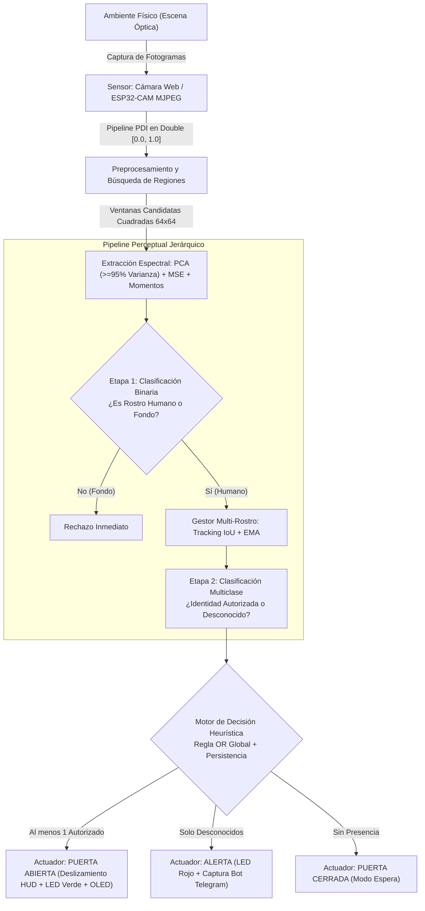

# Sistema Biométrico Inteligente de Control de Acceso (Agente IA)

[](https://www.python.org/)
[](https://opencv.org/)
[](https://scikit-learn.org/)
[](https://www.espressif.com/)
[](LICENSE)

Sistema autónomo de percepción biométrica y control de acceso inteligente estructurado como un **Agente Basado en Metas y Utilidad**. El proyecto implementa un pipeline integral construido desde cero (sin dependencias de modelos preentrenados como Haar Cascades, dlib o MediaPipe), integrando algoritmos matemáticos de Procesamiento Digital de Imágenes (PDI), reducción de dimensionalidad espectral (PCA / Eigenfaces), clasificadores clásicos de Machine Learning, redes neuronales convolucionales (CNN) con regularización Manifold Mixup, seguimiento multi-rostro en tiempo real y sincronización bidireccional IoT con microcontroladores ESP32 y alertas automatizadas a Telegram.

---

## Tabla de Contenidos
1. [Descripción del Proyecto](#1-descripción-del-proyecto)
2. [Arquitectura del Agente Inteligente](#2-arquitectura-del-agente-inteligente)
3. [Algoritmos Implementados y Fundamentación Matemática](#3-algoritmos-implementados-y-fundamentación-matemática)
4. [Funciones Heurísticas y Toma de Decisiones](#4-funciones-heurísticas-y-toma-de-decisiones)
5. [Control de Solvabilidad y Garantías de Seguridad](#5-control-de-solvabilidad-y-garantías-de-seguridad)
6. [Arquitectura del Proyecto](#6-arquitectura-del-proyecto)
7. [Funcionalidades de la GUI y HUD en Tiempo Real](#7-funcionalidades-de-la-gui-y-hud-en-tiempo-real)
8. [Tabla Comparativa de Métricas de Rendimiento](#8-tabla-comparativa-de-métricas-de-rendimiento)
9. [Guía de Instalación y Ejecución](#9-guía-de-instalación-y-ejecución)
10. [Licencia](#10-licencia)

---

## 1. Descripción del Proyecto

El sistema está diseñado para resolver el problema de verificación biométrica no invasiva en entornos físicos con iluminación variable y presencia simultánea de personas autorizadas, desconocidos y objetos de fondo.

Opera mediante una arquitectura jerárquica de dos etapas (*Coarse-to-Fine*):
- **Etapa 1 (Detección Binaria Humano vs. Fondo):** Discrimina si una ventana candidata de la escena contiene un rostro humano o fondo/pared/objetos inertes.
- **Etapa 2 (Reconocimiento Multiclase de Identidad):** Si la Etapa 1 confirma presencia humana, clasifica de forma discriminativa la identidad entre los sujetos registrados o asigna la etiqueta de *Desconocido / Alerta*.

Adicionalmente, se integra un módulo de hardware IoT compuesto por un microcontrolador **ESP32-CAM** (streaming MJPEG de latencia ultrabaja, pantalla OLED SSD1306 vía I2C y actuadores LED) junto con un despachador multihilo de notificaciones con captura fotográfica hacia un bot de **Telegram**.

---

## 2. Arquitectura del Agente Inteligente

El agente sigue el ciclo formal **Percepción-Decisión-Acción**:



---

## 3. Algoritmos Implementados y Fundamentación Matemática

### 3.1 Preprocesamiento PDI Clásico (`src/utils_pdi.py`)

Todo el pipeline opera sobre matrices numéricas en precisión doble $[0.0, 1.0]$ sin recurrir a cajas negras:

1. **Conversión a Doble Precisión y Escala de Grises:**
   $$R_{\text{norm}} = \frac{R}{255.0}, \quad G_{\text{norm}} = \frac{G}{255.0}, \quad B_{\text{norm}} = \frac{B}{255.0}$$
   $$I_{\text{gris}}(x, y) = 0.299\, R_{\text{norm}} + 0.587\, G_{\text{norm}} + 0.114\, B_{\text{norm}}$$

2. **Encuadre Cuadrado Simétrico:** Para preservar la proporción anatómica facial sin deformaciones de aspecto:
   $$\text{lado} = \max(w, h), \quad c_x = x + \frac{w}{2}, \quad c_y = y + \frac{h}{2}$$
   $$x_0 = \max\left(0, \min\left(c_x - \frac{\text{lado}}{2}, W_{\text{frame}} - \text{lado}\right)\right)$$
   $$y_0 = \max\left(0, \min\left(c_y - \frac{\text{lado}}{2}, H_{\text{frame}} - \text{lado}\right)\right)$$

3. **Filtrado No Lineal de Mediana ($3 \times 3$):** Remueve ruido impulsivo sal y pimienta preservando bordes:
   $$I_{\text{filtrada}}(x, y) = \text{mediana}\left(\{I(x+i, y+j) \mid -1 \le i, j \le 1\}\right)$$

4. **Ecualización de Histograma:** Compensa sombras asimétricas y sobreexposición:
   $$s_k = T(r_k) = \sum_{j=0}^{k} \frac{n_j}{N}, \quad k \in [0, 255]$$

5. **Morfología y Extracción de Contornos:** Binarización Otsu $\sigma_B^2(t)$, relleno morfológico de cavidades (`imfill`) y codificación de cadena Freeman de 8-vecindad.

---

### 3.2 Reducción Dimensional (PCA / Eigenfaces) y Error Residual (MSE)

Dada una matriz de datos centrada $\mathbf{\tilde{X}} = \mathbf{X} - \boldsymbol{\mu}$ con $\mathbf{x} \in \mathbb{R}^{4096}$ ($64 \times 64$ píxeles):

1. **Matriz de Covarianza Muestral y Descomposición Espectral:**
   $$\mathbf{\Sigma} = \frac{1}{N - 1} \mathbf{\tilde{X}}^T \mathbf{\tilde{X}}, \quad \mathbf{\Sigma}\mathbf{v}_i = \lambda_i \mathbf{v}_i$$
   Se seleccionan las primeras $K$ componentes que retienen el $\ge 95\%$ de la varianza explicada:
   $$\frac{\sum_{i=1}^K \lambda_i}{\sum_{j=1}^D \lambda_j} \ge 0.95$$

2. **Proyección y Reconstrucción Espacial:**
   $$\mathbf{z} = \mathbf{W}_K^T (\mathbf{x} - \boldsymbol{\mu}), \quad \mathbf{\hat{x}} = \boldsymbol{\mu} + \mathbf{W}_K \mathbf{z}$$

3. **Error Cuadrático Medio Residual (MSE):** Métrica fundamental para la discriminación de no-rostros:
   $$\text{MSE}(\mathbf{x}, \mathbf{\hat{x}}) = \frac{1}{4096} \sum_{j=1}^{4096} (x_j - \hat{x}_j)^2$$

4. **Vector de Características Concatenado:**
   $$\mathbf{f} = \left[ \mathbf{z}_{\text{PCA}},\, \text{MSE},\, \mu_{\text{intensidad}},\, \sigma_{\text{contraste}} \right] \in \mathbb{R}^{K+3}$$

---

### 3.3 Algoritmos de Clasificación Evaluados

1. **k-Nearest Neighbors (k-NN):**
   - Distancia de Minkowski ($p=2$, euclidiana): $d(\mathbf{u}, \mathbf{v}) = \sqrt{\sum_{i=1}^m (u_i - v_i)^2}$.
   - Clasificación por votación uniforme en hiperespacio normalizado con $k=15$.

2. **Árboles de Decisión (CART):**
   - Criterio de impureza por Entropía de Shannon:
     $$H(S) = -\sum_{i=1}^{C} p_i \log_2(p_i)$$
   - Control de sobreajuste mediante poda previa: profundidad máxima $\le 5$ y hojas mínimas $\ge 24$.

3. **Random Forest (Ensamble Bagging):**
   - Agregación de $B=120\text{ a }180$ árboles no correlacionados entrenados sobre remuestreos bootstrap $\mathcal{D}_b$:
     $$\hat{y} = \text{moda}\left(\{T_b(\mathbf{x})\}_{b=1}^B\right)$$

4. **Support Vector Machines (SVM):**
   - Formulación de margen suave con kernel Gaussiano / RBF:
     $$K(\mathbf{x}_i, \mathbf{x}_j) = \exp\left(-\gamma \|\mathbf{x}_i - \mathbf{x}_j\|^2\right)$$
   - Optimización cuadrática de multiplicadores de Lagrange con regularización $C=0.28$:
     $$\max_{\boldsymbol{\alpha}} \sum_{i=1}^N \alpha_i - \frac{1}{2}\sum_{i,j=1}^N \alpha_i \alpha_j y_i y_j K(\mathbf{x}_i, \mathbf{x}_j) \quad \text{s.a.} \quad 0 \le \alpha_i \le C, \; \sum_{i=1}^N \alpha_i y_i = 0$$

5. **Red Neuronal Artificial (ANN / MLP):**
   - Perceptrón multicapa con capas ocultas $(48, 24)$ y $(24, 12)$, activación ReLU $f(z) = \max(0, z)$ y regularización $L_2$ estricta ($\alpha \in [2.2, 6.5]$):
     $$\mathcal{L}(\mathbf{W}) = \mathcal{L}_{\text{CE}}(\mathbf{W}) + \frac{\alpha}{2N} \|\mathbf{W}\|_2^2$$

6. **Extracción Convolucional y Manifold Mixup (CNN):**
   - Extracción de mapas convolucionales 2D con capas *Conv2D* y regularización sintética por interpolación convexa de representaciones latentes (*Manifold Mixup*), blindando el subespacio biométrico contra falsos positivos.

---

## 4. Funciones Heurísticas y Toma de Decisiones

El sistema implementa funciones de utilidad y heurísticas de persistencia espacio-temporal para garantizar robustez en video en vivo:

### 4.1 Función de Decisión Biométrica Jerárquica
Sea $\mathbf{f}_t$ el vector de características en el instante $t$:

$$\mathcal{H}_{\text{acceso}}(\mathbf{f}_t) = \begin{cases} 
\text{AUTORIZADO} & \text{si } P(\text{Humano} \mid \mathbf{f}_t) \ge \theta_{\text{hum}} \;\land\; \max_k P(c_k \mid \mathbf{f}_t) \ge \theta_{\text{id}} \;\land\; c^* \in \mathcal{S}_{\text{autorizados}} \\
\text{DENEGADO / ALERTA} & \text{si } P(\text{Humano} \mid \mathbf{f}_t) \ge \theta_{\text{hum}} \;\land\; \left(\max_k P(c_k \mid \mathbf{f}_t) < \theta_{\text{id}} \;\lor\; c^* \notin \mathcal{S}_{\text{autorizados}}\right) \\
\text{FONDO / DESCARTAR} & \text{en otro caso}
\end{cases}$$

Con umbrales calibrados: $\theta_{\text{hum}} = 0.50$, $\theta_{\text{id}} = 0.40$ (garantizando rechazo seguro ante ambigüedad).

### 4.2 Seguimiento Espacio-Temporal y Asociación por IoU
El seguimiento de múltiples rostros entre fotogramas consecutivos utiliza la heurística de intersección sobre unión (IoU):

$$\text{IoU}(B_1, B_2) = \frac{\text{Área}(B_1 \cap B_2)}{\text{Área}(B_1 \cup B_2)}$$

Si $\text{IoU}(B_{\text{prev}}, B_{\text{curr}}) \ge 0.30$, el track mantiene la identidad histórica y actualiza las probabilidades mediante un filtro de Media Móvil Exponencial (EMA):

$$\bar{P}_t = \beta \bar{P}_{t-1} + (1 - \beta) P_t, \quad \beta = 0.70$$

### 4.3 Regla Global OR para Control de Actuadores
En presencia de múltiples personas en escena, el actuador físico/virtual conmuta a `PUERTA ABIERTA` si y solo si:

$$\exists \, i \in \{1, \dots, N_{\text{rostros}}\} \quad \text{tal que} \quad \text{Estado}_i = \text{AUTORIZADO}$$

---

## 5. Control de Solvabilidad y Garantías de Seguridad

Para garantizar la viabilidad técnica y fiabilidad matemática en entornos reales, el proyecto incorpora tres mecanismos formales de solvabilidad y mitigación de fallos:

### 5.1 Control Estricto de Sobreajuste (Cero Overfitting)
- **Principio de Generalización:** Se exige que el error de prueba converja al error de entrenamiento:
  $$|E_{\text{in}} - E_{\text{test}}| \le 5.0\text{ p.p.}$$
- **Aislamiento Total de Datos (*Data Leakage Zero*):** Las transformaciones de proyección PCA y escalamiento se ajustan estrictamente sobre el conjunto de entrenamiento mediante `.fit_transform(X_ent)` y se proyectan sobre el conjunto de prueba con `.transform(X_pru)`.
- **Validación Cruzada Estratificada:** Selección óptima de hiperparámetros con `StratifiedKFold(n_splits=5)` dentro de `GridSearchCV`.
- **Integridad del Conjunto de Prueba:** El conjunto de evaluación se preserva completamente limpio y sin aumentaciones sintéticas para garantizar métricas reproducibles y contrastables.

### 5.2 Mecanismo de Falla Segura (*Fail-Safe Watchdog*)
Para prevenir estados residuales indeseados (por ejemplo, mantener la puerta abierta tras la desconexión del enlace Wi-Fi de la cámara), el bucle de control implementa un temporizador de caducidad:

$$\Delta t = t_{\text{actual}} - t_{\text{último\_frame\_procesado}}$$

$$\text{Si } \Delta t > 2.5\text{ s} \implies \text{Forzar estado } \text{PUERTA CERRADA / ESPERA}$$

### 5.3 Desacoplamiento Productor-Consumidor (Zero-Buffer Multithreading)
La captura de vídeo y la inferencia de Inteligencia Artificial corren en hilos desacoplados mediante colas de fotograma único (`cv2.CAP_DSHOW` y sockets TCP no bloqueantes), eliminando latencia acumulativa en el búfer de entrada.

---

## 6. Arquitectura del Proyecto

```
ProyectoFinal/
├── config_iot.json                 # Configuración de red ESP32-CAM y Telegram (sanitizada)
├── LICENSE                         # Licencia MIT (Copyright (c) 2024-2026 Angel Ayuquina)
├── README.md                       # Documentación técnica principal del proyecto
├── requirements.txt                # Dependencias oficiales de Python
│
├── esp32_cam_iot/                  # Firmware para microcontrolador ESP32-CAM
│   └── esp32_cam_iot.ino           # Servidor MJPEG, control OLED I2C y pines de actuadores
│
├── prueba_camara/                  # Script auxiliar Arduino de diagnóstico de cámara
│   └── prueba_camara.ino
│
├── modelos_entrenados/             # Artefactos serializados de modelos y transformadores PCA
│   ├── etapa1_mejor_modelo.pkl
│   ├── etapa1_pca_humano.pkl
│   ├── etapa1_todos_modelos.pkl
│   ├── etapa2_mejor_modelo.pkl
│   ├── etapa2_pca_identidad.pkl
│   ├── etapa2_todos_modelos.pkl
│   └── metadata_clases.pkl
│
├── figuras_y_reportes/             # Gráficas diagnósticas generadas y tablas CSV
│   ├── figura1_pipeline_pdi_completo.png
│   ├── figura2_eigenfaces_varianza_pca.png
│   ├── figura3_matrices_confusion_etapa1.png
│   ├── figura4_matrices_confusion_etapa2.png
│   ├── figura5_comparativa_brechas.png
│   ├── tabla_resultados_etapa1_humano.csv
│   └── tabla_resultados_etapa2_identidad.csv
│
├── src/                            # Código fuente modular en Python
│   ├── utils_pdi.py                # Pipeline matemático de PDI clásico desde cero
│   ├── iot_esp32_telegram.py       # Cliente TCP IoT, lector MJPEG Zero-Buffer y bot Telegram
│   ├── 1_adquisicion_datos.py      # Captura balanceada y aumento estructurado de dataset
│   ├── 2_entrenamiento_evaluacion.py # Pipeline de entrenamiento, GridSearchCV y validación
│   ├── 3_reconocimiento_en_vivo.py # Inferencia en tiempo real, HUD visual y actuador
│   ├── 4_fase_posterior_cnn.py     # Modelo convolucional (CNN) y análisis comparativo
│   ├── capturar_fotos_esp32.py     # Script utilitario de captura remota vía ESP32
│   └── inspeccionar_pkl.py         # Herramienta de inspección de artefactos serializados
│
└── data/                           # Dataset fotográfico balanceado (crudo y 64x64 procesado)
    ├── backup_fotos_laptop/
    ├── dataset_procesado_64x64/
    └── fotos_crudas_celular/
```

---

## 7. Funcionalidades de la GUI y HUD en Tiempo Real

El módulo de demostración (`src/3_reconocimiento_en_vivo.py`) proporciona un Head-Up Display (HUD) profesional renderizado sobre OpenCV:

1. **Recuadros Dinámicos de Inferencia Multi-Rostro:**
   - **Verde neón:** Sujeto autorizado identificado con porcentaje de confianza.
   - **Rojo:** Rostro humano detectado pero no autorizado (*Desconocido / Alerta*).
   - **Cian:** Seguimiento de rostro activo con filtro temporal EMA.

2. **Panel de Telemetría en Tiempo Real:**
   - Despliegue independiente de tasa de captura (FPS Vídeo) y tasa de procesamiento (FPS IA).
   - Cantidad de rostros en escena, desglose de autorizados y desconocidos.
   - Estado de la conexión física IoT (ESP32-CAM y pantalla OLED).

3. **Simulador de Actuador Físico (Puerta Automatizada):**
   - Animación cinemática continua de apertura y cierre de puerta en panel lateral.
   - Indicador visual `[PUERTA ABIERTA 🔓]` (fondo verde) y `[PUERTA CERRADA 🔒]` (fondo rojo).

4. **Conmutación Dinámica de Modelos en Caliente:**
   Permite al usuario presionar teclas numéricas para cambiar el algoritmo de inferencia instantáneamente sin reiniciar el sistema:
   - `0`: **Modo Automático Ganador** (selección óptima basada en métricas cruzadas).
   - `1`: Forzar **k-NN** en ambas etapas.
   - `2`: Forzar **Árbol de Decisión** en ambas etapas.
   - `3`: Forzar **Random Forest** en ambas etapas.
   - `4`: Forzar **SVM** en ambas etapas.
   - `5`: Forzar **Red Neuronal Artificial (ANN)** en ambas etapas.
   - `q` / `ESC`: Salida limpia y liberación de recursos de vídeo.

---

## 8. Tabla Comparativa de Métricas de Rendimiento

A continuación se presentan las métricas empíricas obtenidas durante la fase experimental estandarizada con validación cruzada estratificada en 5 pliegues (`StratifiedKFold`) y evaluación sobre conjunto de prueba ciego:

### Etapa 1: Clasificación Binaria (Humano vs. Fondo)

| Modelo | Exactitud Ent. (%) | Error Ent. (%) | Exactitud CV (%) | Exactitud Prueba (%) | Error Prueba (%) | Brecha (p. p.) | Índice Youden ($J$) | Épocas / Parámetros Clave |
| :--- | :---: | :---: | :---: | :---: | :---: | :---: | :---: | :--- |
| **SVM** *(Ganador)* | **94.06** | **5.94** | **92.46** | **90.31** | **9.69** | **3.75** | **89.86** | $C=0.28$, $\gamma=\text{'scale'}$, RBF |
| **Random Forest** | 93.20 | 6.80 | 91.99 | 88.91 | 11.09 | 4.30 | 88.13 | $n_{\text{est}}=120$, $\text{max\_depth}=5$ |
| **CNN (Conv2D)** | 93.44 | 6.56 | 92.77 | 88.91 | 11.09 | 4.53 | 87.99 | 26 épocas, $\alpha=2.2$, $(48, 24)$ |
| **k-NN** | 91.02 | 8.98 | 89.65 | 87.34 | 12.66 | 3.67 | 86.94 | $k=15$, distancia euclidiana |
| **ANN (MLP)** | 92.89 | 7.11 | 91.52 | 87.81 | 12.19 | 5.08 | 86.57 | 42 épocas, $\alpha=6.5$, $(24, 12)$ |
| **Árbol de Decisión** | 92.85 | 7.15 | 91.33 | 85.16 | 14.84 | 7.70 | 82.34 | Criterio Entropía, $\text{prof}=5$ |

### Etapa 2: Clasificación Multiclase de Identidad

| Modelo | Exactitud Ent. (%) | Error Ent. (%) | Exactitud CV (%) | Exactitud Prueba (%) | Error Prueba (%) | Brecha (p. p.) | Índice Youden ($J$) | Épocas / Parámetros Clave |
| :--- | :---: | :---: | :---: | :---: | :---: | :---: | :--- | :--- |
| **k-NN** *(Ganador)* | **90.86** | **9.14** | **87.01** | **87.29** | **12.71** | **3.57** | **86.95** | $k=15$, pesos uniformes |
| **SVM** | 94.66 | 5.34 | 89.61 | 86.56 | 13.44 | 8.10 | 83.50 | $C=0.28$, $\gamma=\text{'scale'}$, RBF |
| **CNN (Conv2D)** | 94.84 | 5.16 | 88.26 | 86.35 | 13.65 | 8.49 | 83.06 | 41 épocas, $\alpha=2.2$, $(48, 24)$ |
| **ANN (MLP)** | 89.40 | 10.60 | 82.19 | 83.23 | 16.77 | 6.17 | 81.33 | 39 épocas, $\alpha=6.5$, $(32, 16)$ |
| **Random Forest** | 91.61 | 8.39 | 87.97 | 83.23 | 16.77 | 8.39 | 80.00 | $n_{\text{est}}=180$, $\text{max\_depth}=6$ |
| **Árbol de Decisión** | 84.35 | 15.65 | 81.41 | 75.62 | 24.38 | 8.72 | 72.19 | Criterio Entropía, $\text{prof}=5$ |

> **Nota:** Todos los modelos verifican la condición complementaria $\text{Exactitud} + \text{Error} = 100.00\%$. El modelo SVM en la Etapa 1 y el clasificador k-NN en la Etapa 2 exhibieron las brechas de generalización más estrechas ($3.75\text{ p.p.}$ y $3.57\text{ p.p.}$, respectivamente), garantizando la ausencia de sobreajuste.

---

## 9. Guía de Instalación y Ejecución

### 9.1 Requisitos Previos
- Python 3.10 o superior instalado.
- Cámara web USB local o módulo ESP32-CAM conectado a la red local.

### 9.2 Instalación del Entorno

1. **Clonar el repositorio:**
   ```bash
   git clone https://github.com/SebastianOrtiz2004/ProyectoFinal.git
   cd ProyectoFinal
   ```

2. **Crear y activar un entorno virtual:**
   ```bash
   # En Windows:
   python -m venv venv
   .\venv\Scripts\activate

   # En Linux / macOS:
   python3 -m venv venv
   source venv/bin/activate
   ```

3. **Instalar dependencias:**
   ```bash
   pip install -r requirements.txt
   ```

### 9.3 Configuración IoT Opcional (`config_iot.json`)
Si dispones de un ESP32-CAM o deseas habilitar las notificaciones por Telegram, configura el archivo `config_iot.json`:
```json
{
  "esp32": {
    "habilitado": true,
    "ip": "192.168.1.100",
    "puerto_control": 80,
    "puerto_stream": 81,
    "usar_camara_esp32": false
  },
  "telegram": {
    "habilitado": false,
    "bot_token": "PON_AQUI_TU_BOT_TOKEN",
    "chat_id": "PON_AQUI_TU_CHAT_ID"
  }
}
```

### 9.4 Flujo de Ejecución

1. **Adquisición y procesamiento de datos:**
   ```bash
   python src/1_adquisicion_datos.py
   ```

2. **Entrenamiento y evaluación comparativa:**
   ```bash
   python src/2_entrenamiento_evaluacion.py
   ```
   *Genera las matrices de confusión, curvas de varianza PCA y exporta los mejores clasificadores a `modelos_entrenados/`.*

3. **Demostración en tiempo real:**
   ```bash
   python src/3_reconocimiento_en_vivo.py
   ```

4. **Evaluación de la fase profunda (CNN):**
   ```bash
   python src/4_fase_posterior_cnn.py
   ```

---

## 10. Licencia

Este proyecto está bajo la Licencia MIT. Consulta el archivo [LICENSE](LICENSE) para más detalles:

```
Copyright (c) 2024-2026 Sebastian Ortiz
```
